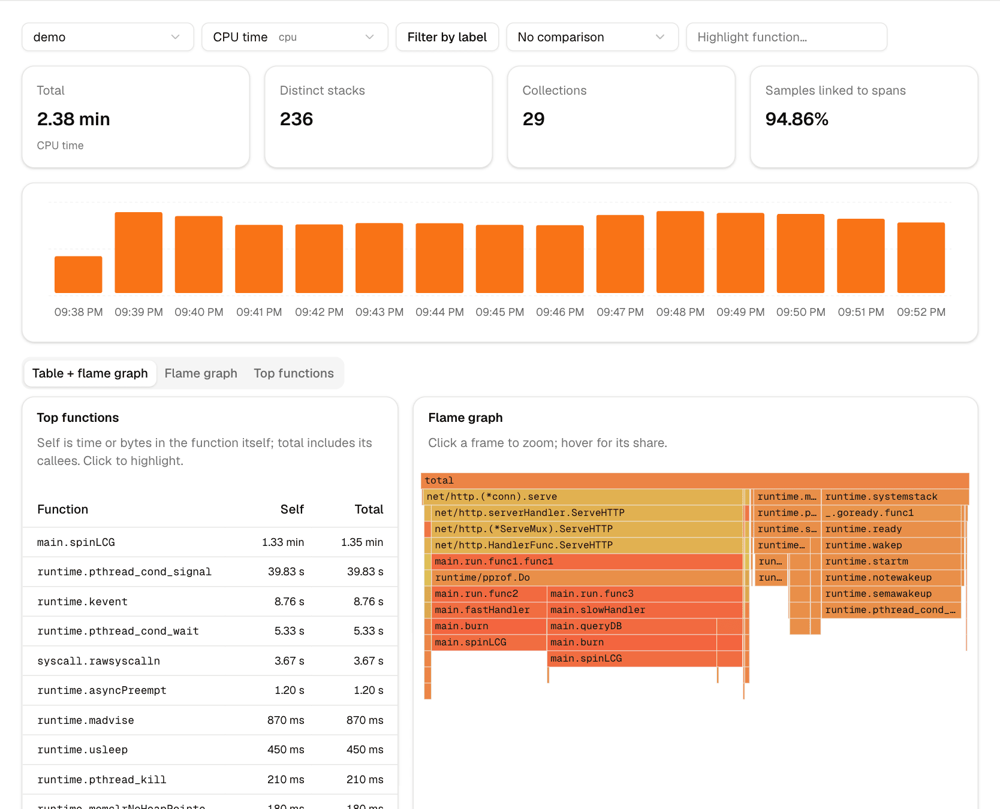
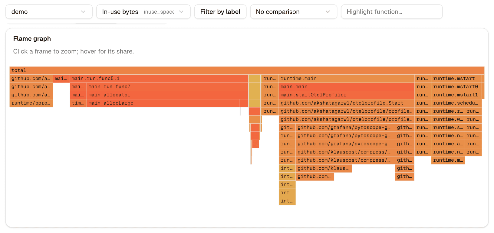
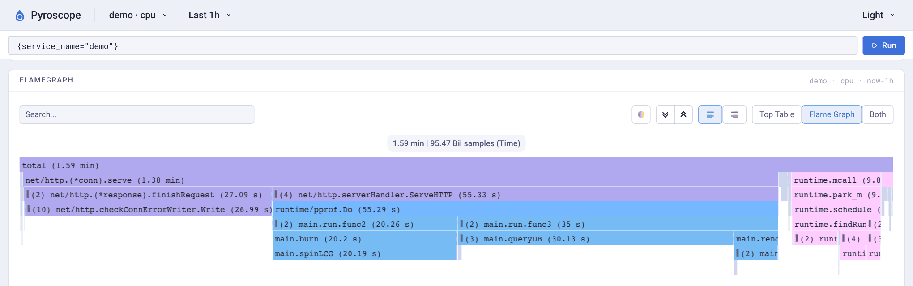
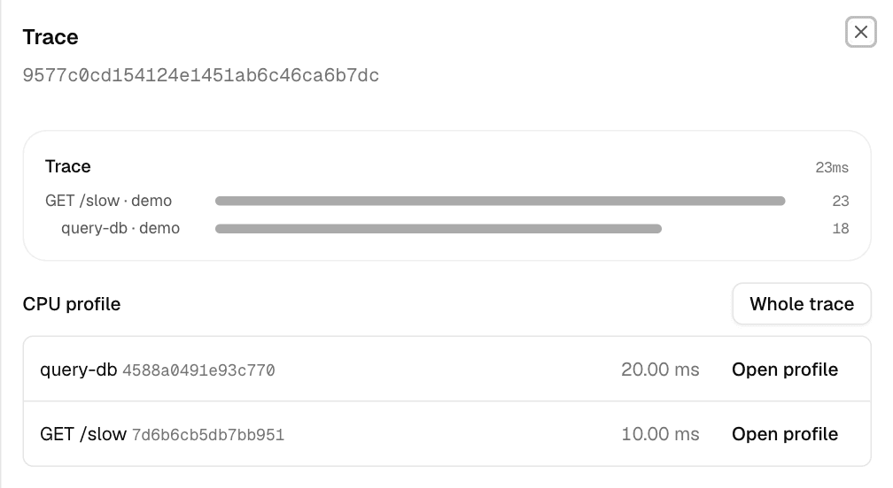
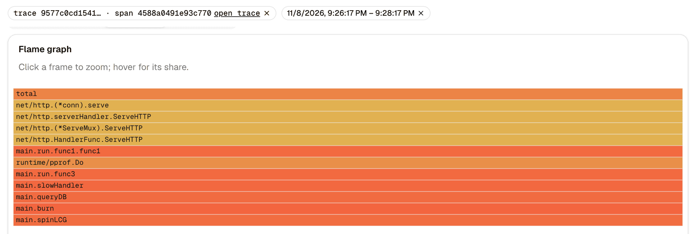

# otelprofile

Continuous profiling for Go that pushes standard **OTLP Profiles**. One call
starts it; any OTLP profiles receiver can store it; CPU samples carry the
trace and span that produced them.

<p align="center">
  
  <br><sub>Fifteen minutes of <code>examples/demo</code> CPU time, as sent by otelprofile, in <a href="https://sigiro.com">sigiro</a>.</sub>
</p>

> **Status: v0.2.0, experimental.** OTLP Profiles is still a *development*
> signal (`/v1development/profiles`, opentelemetry-proto v1.10+ layout,
> profiles development revision 1). The wire format will change before it is
> stable, and so may this module's API.

## What it does



Every 15 seconds (CPU every 30) it reads the Go runtime's profiles, turns
them into one OTLP request and posts it. Nothing else to run.

Heap in use, same app:



The same data in Grafana Pyroscope, through its OTLP endpoint:



## Quickstart (about 3 minutes)

You need Go 1.26+ and Docker.

1. Start an OpenTelemetry Collector that prints the profiles it receives
   (`scripts/collector/config.yaml` in this repository):

   ```sh
   cat > collector.yaml <<'YAML'
   receivers:
     otlp:
       protocols:
         http:
           endpoint: 0.0.0.0:4318
   exporters:
     debug:
       verbosity: detailed
   service:
     pipelines:
       profiles:
         receivers: [otlp]
         exporters: [debug]
   YAML
   docker run -d --name otelcol -p 4318:4318 -v $PWD/collector.yaml:/etc/otelcol-contrib/config.yaml \
     otel/opentelemetry-collector-contrib:latest \
     --config /etc/otelcol-contrib/config.yaml --feature-gates=service.profilesSupport
   ```

2. Create `main.go`:

   ```go
   package main

   import (
   	"log"
   	"time"

   	"github.com/akshatagarwl/otelprofile"
   )

   func main() {
   	p, err := otelprofile.Start(otelprofile.Config{
   		ServiceName: "quickstart",
   		Endpoint:    "http://localhost:4318",
   	})
   	if err != nil {
   		log.Fatal(err)
   	}
   	defer p.Stop()

   	for start := time.Now(); time.Since(start) < 40*time.Second; {
   		work()
   	}
   }

   func work() {
   	x := 0
   	for i := 0; i < 1e7; i++ {
   		x += i % 7
   	}
   	_ = x
   }
   ```

3. Run it (about 40 seconds):

   ```sh
   go mod init quickstart
   go get github.com/akshatagarwl/otelprofile@v0.2.0
   go run .
   ```

4. Profiles upload every 15 seconds (CPU every 30 seconds) and once more on
   `Stop`. The collector logs each batch:

   ```sh
   docker logs otelcol 2>&1 | grep -E 'Str\(quickstart\)|sample records|main\.work' | head
   docker rm -f otelcol
   ```

Point `Endpoint` at any OTLP/HTTP profiles receiver instead, or leave it
empty and set `OTEL_EXPORTER_OTLP_ENDPOINT`.

## Receivers

Receivers tested in CI or by hand:

| Receiver | Result |
|---|---|
| OpenTelemetry Collector 0.165.0 (`otlp` receiver, `debug` exporter, `service.profilesSupport` gate) | All types, span links (CI) |
| Grafana Pyroscope 2.4.3 (OTLP endpoint on port 4040) | All types (CI). Mutex and block profiles both land under Pyroscope's `contentions` type, so they are not told apart there. |
| sigiro | All types, labels, span links, trace → profile view |

## Configuration

<details>
<summary>Every <code>Config</code> field and its environment variable</summary>

Every `Config` field has an environment variable, so
`otelprofile.Start(otelprofile.Config{})` is enough when these are set.
Explicit fields win over the environment.

| Config field | Environment | Default |
|---|---|---|
| `ServiceName` | `OTEL_SERVICE_NAME` | `unknown_service:<exe>` |
| `Endpoint` (base URL or full `/v1development/profiles` URL) | `OTEL_EXPORTER_OTLP_PROFILES_ENDPOINT` (full URL), `OTEL_EXPORTER_OTLP_ENDPOINT` (base URL) | `http://localhost:4318` |
| `Headers` | `OTEL_EXPORTER_OTLP_[PROFILES_]HEADERS` (`k=v,k2=v2`) | none |
| `Tags` (static key/values on every profile) | `OTEL_RESOURCE_ATTRIBUTES` | host, OS, process, runtime, `service.instance.id` |
| `ProfileTypes` | `OTEL_GO_X_PROFILES_TYPES` (`cpu,heap,goroutine,mutex,block` or `all`) | `cpu,heap` |
| `Interval` | `OTEL_GO_X_PROFILES_INTERVAL` (`15s`) | 15s |
| `CPUWindow` (length of each CPU profile) | `OTEL_GO_X_PROFILES_CPU_WINDOW` | 2 × `Interval` (30s). Each CPU profiler restart costs the Go runtime ~2 MB, so CPU profiles cover two intervals. Set it to `Interval` for 15s CPU resolution. |
| `MutexProfileFraction`, `BlockProfileRate` | none | 5 and 10µs, only when the type is enabled; restored on `Stop` |
| `RuntimeDeltas` (experimental) | `OTEL_GO_X_PROFILES_RUNTIME_DELTAS=true` | false. Compute heap, mutex and block deltas from runtime/pprof's public API instead of godeltaprof (which uses `go:linkname`); same data, see `docs/delta-without-linkname.md` for the cost. |
| `DisableGCRuns` | none | false (a GC runs before a heap collection if none ran in the window, so in-use figures stay current) |
| — | `OTEL_EXPORTER_OTLP_[PROFILES_]TIMEOUT`, `_COMPRESSION` (`gzip` or `none`), `_CERTIFICATE`, `_CLIENT_CERTIFICATE`, `_CLIENT_KEY` | 10s, none (the OTLP default) |
| — | `OTEL_SDK_DISABLED=true` turns `Start` into a no-op | |

Errors (an unreachable endpoint, a rejected request) are logged through
`Config.Logger` (default `slog.Default()`), never returned after `Start` and
never fatal. Repeats of the same error within a minute are collapsed.

</details>

## Profile types

| Type | What you get | Notes |
|---|---|---|
| `cpu` | `cpu` (nanoseconds) and `samples` | 100 Hz, one profile per `CPUWindow`. If another CPU profiler holds the runtime's profiler, the window is skipped and retried. |
| `heap` | `alloc_objects`, `alloc_space` (deltas over the window), `inuse_objects`, `inuse_space` | via godeltaprof |
| `goroutine` | `goroutines` | snapshot |
| `mutex` | `mutex_count`, `mutex_duration` (deltas) | opt-in; sets the mutex profile fraction |
| `block` | `block_count`, `block_duration` (deltas) | opt-in; sets the block profile rate |

## Dynamic labels

Wrap a code region to label every CPU and goroutine sample it produces.
Labels become OTLP sample attributes, which backends can filter on:

```go
otelprofile.TagWrapper(ctx, otelprofile.Labels("endpoint", "/checkout"), func(ctx context.Context) {
	handleCheckout(ctx)
})
```

## Profiles linked to traces



Wrap your tracer provider:

```go
tp := sdktrace.NewTracerProvider(...)
otel.SetTracerProvider(profiletrace.NewTracerProvider(tp))
```

A backend can then list the spans of a trace that used CPU:



and open the profile of one span (here `query-db`):



`profiletrace.WithScope(profiletrace.ScopeRoot)` labels only local root
spans, which is cheaper.

## Inside the OTLP request



Each request carries one deduplicated dictionary; a sample is a few
integers. The encoder passes `profcheck` with every check enabled.

## Overhead



Less CPU than pyroscope-go, similar allocations, about 0.6 MB more memory
(reused encoder state). Every soak, darwin and linux, and the accuracy
comparison are in [SCORECARD.md](SCORECARD.md).

## Packages

- `otelprofile`: the one-call `Start`, `TagWrapper`, `Labels`.
- `profile`: the collector (`NewProfiler`, `WithTypes`, `WithInterval`, ...),
  shaped like a future `go.opentelemetry.io/otel/sdk/profile`.
- `otlpprofilehttp`: the OTLP/HTTP exporter (gzip, retries with
  `Retry-After`, partial success, request size cap).
- `profiletrace`: span-to-profile links.
- `internal/transform`: pprof to OTLP (one dictionary per request, deduplicated,
  passes `profcheck` with every check enabled).

## Development

```sh
go test ./...                     # unit, golden and conformance tests
go test ./internal/transform -run x -fuzz FuzzTransform -fuzztime 1m
golangci-lint run ./...
```

Coming from pyroscope-go? `Start`, `TagWrapper` and `Labels` work the same
way, and `ProfileTypes` accepts pyroscope-go's type names.

`examples/demo` is the benchmark app behind `SCORECARD.md` and
`ROUNDS.md`, which record how v0.1.0 was measured (accuracy against
pyroscope-go, overhead in 32-minute soaks); `evidence/` holds the text
evidence.

## License

Apache License 2.0; see `LICENSE` and `NOTICE`.
