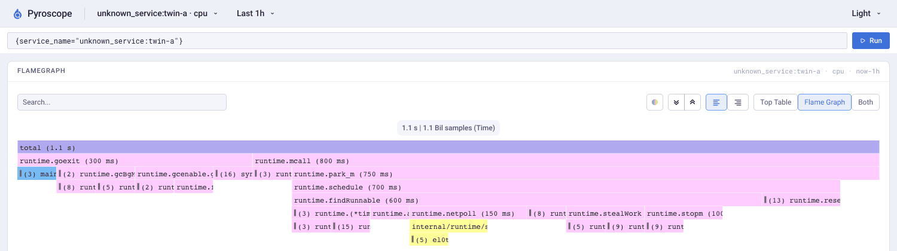

# otelprofile vs the OpenTelemetry eBPF profiler

Two identical copies of [`examples/demo`](../examples/demo) ran side by side
for 15 minutes on one Linux kernel. One copy profiled itself with
otelprofile; the other linked no profiler. The
[OpenTelemetry eBPF profiler](https://github.com/open-telemetry/opentelemetry-ebpf-profiler)
profiled the whole machine at the same time. Both sent OTLP through one
Collector into Grafana Pyroscope 2.4.3. Ground truth is each process's own
CPU time (`getrusage`).

| | otelprofile | eBPF profiler |
|---|---|---|
| Setup | `otelprofile.Start(...)` in `main` | Privileged container with host PID, one per node, Linux only |
| Go profile types | CPU, heap (alloc and in-use), goroutine, mutex, block | CPU. The off-CPU probe would not start on this kernel. There is no Go heap profile. |
| CPU profiled ÷ CPU used | **98.7 %** | **97.7 %** at 97 Hz. At the default 20 Hz: **3 % to 138 %** ([below](#the-default-rate-can-miss-the-hot-path)) |
| Caller of a leaf function (arm64) | Kept | **Dropped** in 12,436 of 12,436 samples |
| Inlined Go functions in stacks | 177 | 1 of those 177 |
| pprof labels (`endpoint`) | 86.7 % of CPU, filterable in Pyroscope | 84.2 % of CPU, sent as `process.context.label.endpoint`, which Pyroscope 2.4.3 does not index |
| Trace and span links | 86.9 % of CPU samples | None for plain Go (needs [OBI](https://github.com/open-telemetry/opentelemetry-ebpf-instrumentation/blob/main/devdocs/trace-profile-correlation.md), not tested) |
| Kernel frames | No | **Yes**, on 5.4 % of samples |
| Other languages, whole host, no rebuild | No | **Yes** |
| Cost | CPU: −0.04 % and +2.2 % in two runs. Max RSS: about +10 MB. | Agent: 0.5 % of one core, 52 to 91 MiB of container memory. Kernel: 1.9 µs per sample, 1.3 s per 15 min across 8 CPUs. |

## Leaf callers go missing


<sub><b>otelprofile</b>, searching for <code>main.burn</code>: it sits between each handler and <code>main.spinLCG</code>.</sub>


<sub><b>eBPF profiler</b> at 97 Hz on the other copy, same search: <code>main.burn</code> never appears.</sub>

`main.spinLCG` is a leaf function that saves no frame on arm64. For Go
1.21 and later on arm64, the eBPF profiler unwinds Go code by frame pointer
only
([`elfgopclntab.go`](https://github.com/open-telemetry/opentelemetry-ebpf-profiler/blob/792e6d8ee0cb17d895082237bea5a786194ced48/nativeunwind/elfunwindinfo/elfgopclntab.go#L940-L944)).
That skips the caller of every such leaf. x86-64 was not tested.

## The default rate can miss the hot path


<sub>Default 20 Hz, one of two identical copies. It found 1.1 s of CPU, but the process used 29.1 s. <code>main.spinLCG</code>, about 85 % of the real CPU, barely shows.</sub>

| eBPF rate | CPU profiled ÷ CPU used, two identical processes (2.5 to 15 min runs) |
|---|---|
| 20 Hz (default) | 0.10 / 1.38 · 0.04 / 0.03 |
| 100 Hz | 0.63 / 1.24 · 0.68 / 1.20 · 0.78 / 1.05 |
| 97 Hz | 0.98 / 0.98 · 0.98 / 0.94 |
| otelprofile (100 Hz) | 0.99 |

The eBPF profiler samples every CPU on a wall-clock timer
([`cpu-clock`](https://github.com/open-telemetry/opentelemetry-ebpf-profiler/blob/792e6d8ee0cb17d895082237bea5a786194ced48/tracer/tracer.go#L1442-L1444)).
The demo starts its work from 50 ms tickers. A sampling period that divides
50 ms lines up with that work, so samples keep landing in the same moments.
This is the lockstep sampling that
[perf's 99 Hz convention](https://www.brendangregg.com/perf.html) avoids.
Go's profiler fires after every 10 ms of a thread's own CPU time
([per-thread timers since Go 1.18](https://go.dev/doc/go1.18#runtime/pprof)),
so it can't line up with wall-clock work. If you run the eBPF profiler, set
`samples_per_second` to a prime such as 19 or 97. Services with irregular
request timing should alias less than this demo. Ticker-driven loops can
alias this much.

## Where eBPF is the better tool

- One agent covers every process and language on the host, with no rebuild
  or restart.
- Its stacks include the kernel: scheduler, futex and network frames.
  otelprofile shows only Go frames.
- It can profile binaries you can't change.

## What it took to run here

- `--privileged --pid=host` and the `/sys/kernel/debug` and `/sys/fs/cgroup`
  mounts
  ([`local.example.yaml`](https://github.com/open-telemetry/opentelemetry-ebpf-profiler/blob/792e6d8ee0cb17d895082237bea5a786194ced48/cmd/otelcol-ebpf-profiler/local.example.yaml)).
- OrbStack runs Docker in a nested PID namespace. The profiler failed until
  `pid_namespace_translation_mode: auto` was set. The error was `system
  analysis request was not handled`.
- 2 of 17 starts failed with `system analysis helper failed at 0x20: bad
  address`. The scripts retry.
- The `offcpu` probe failed: `no finish_task_switch symbols found in
  /proc/kallsyms`.
- No macOS support. otelprofile runs wherever Go runs.

## Versions and reproduction

| | |
|---|---|
| Kernel | 7.2.12-orbstack, aarch64, 8 vCPUs (OrbStack on macOS) |
| eBPF profiler | `otel/opentelemetry-collector-ebpf-profiler` 0.165.0 (`sha256:793cc2b4…`), receiver v0.0.202645 ([`792e6d8`](https://github.com/open-telemetry/opentelemetry-ebpf-profiler/commit/792e6d8ee0cb17d895082237bea5a786194ced48)), Go symbolization and Go labels on (defaults) |
| otelprofile | this repository at `c22dda4`, all profile types, `profiletrace` on |
| Go, Collector, Pyroscope | 1.27.3, contrib 0.165.0, 2.4.3 |

```sh
EBPF=1 HZ=97 scripts/vs-ebpf/run.sh 15 /tmp/vsebpf/run      # 15 min, both profilers
HZ=20 scripts/vs-ebpf/probe.sh 150 /tmp/vsebpf/p a b         # rate check: eBPF vs rusage
python3 scripts/vs-ebpf/analyze.py /tmp/vsebpf/run/profiles.jsonl demo-none
cd e2e && node pyroscope.mjs demo process_cpu/cpu out.png --hidechart=1 --expand=1 --search=main.burn
```

The summaries are in [`evidence/vs-ebpf/`](../evidence/vs-ebpf).
