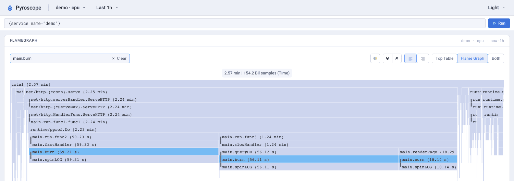
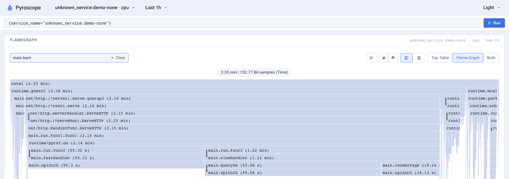

# otelprofile vs the OpenTelemetry eBPF profiler

**For this Go workload, use otelprofile for Go-native profiles, faithful Go
stacks and application-span links. Use eBPF for no-rebuild, whole-host,
cross-language and kernel visibility.** Both measured process CPU closely at
97 Hz. eBPF also collected useful native off-CPU stacks and, with OBI, linked
CPU samples to automatically generated HTTP spans.

These are measurements, not a universal ranking. We tested the official
[OpenTelemetry eBPF profiler](https://github.com/open-telemetry/opentelemetry-ebpf-profiler)
collector 0.165.0, collector-contrib 0.165.0 and Go 1.27.3. Original screenshots
use Pyroscope 2.4.3. [Text evidence](../evidence/vs-ebpf/README.md) includes
commands, runner metadata, logs and machine-readable reports.

## What was compared

[`examples/demo`](../examples/demo) serves `/fast` and `/slow`; the latter calls
`queryDB` and `renderPage`. Each deliberately calls a non-inlined `main.burn`
which calls the hot leaf `main.spinLCG`. HTTP handlers carry Go pprof labels
and, unless explicitly disabled for the OBI test, OpenTelemetry spans.

Two builds run side by side with identical request settings:

* `demo-otel` / `qotel`: otelprofile, all profile types, trace links.
* `demo-none` / `qnone`: built with `nootel,nopyro`, no profiling library.

The eBPF agent profiles **both**, the collector and the host. Quality comparisons
below can therefore inspect the **same instrumented process** with both profilers;
plain-process results are also reported. The screenshots show the two builds.
Separate no-eBPF runs are used for overhead, not for quality.

Ground truth is each process's `getrusage` user + system CPU, not another
profiler. CPU sample counts are multiplied by the exported period. Wall-clock
percentages and Docker's CPU percentages are not substituted for process CPU.
Rusage is recorded before final shutdown/flush, so export tail coverage and
shutdown cost are not fully captured. Short runs have more boundary error.

## Stock Ubuntu: both architectures

[Run 42620801530](https://github.com/akshatagarwl/otelprofile-go/actions/runs/42620801530)
ran the 300-second quality probe on fresh GitHub-hosted runners, eBPF at 97 Hz.
Both architecture jobs passed; the run overall failed on its first Kubernetes
attempt, which was subsequently fixed and rerun.

| | x86-64 | arm64 |
|---|---:|---:|
| OS | Ubuntu 26.04.1 | Ubuntu 24.04.5 |
| Kernel | `7.0.0-1019-azure` | `7.0.0-1017-azure` |
| vCPUs | 4 | 4 |
| `qotel` rusage CPU | 35.701 s | 32.477 s |
| otelprofile CPU | 35.28 s / **98.8 %** | 32.11 s / **98.9 %** |
| eBPF CPU, same `qotel` | 34.86 s / **97.6 %** | 31.15 s / **95.9 %** |
| eBPF CPU ÷ rusage, plain `qnone` | **98.7 %** | **96.0 %** |
| `spinLCG` leaf samples retaining `burn`, otelprofile | **2,534 / 2,534** | **2,103 / 2,103** |
| Same caller check, eBPF on `qotel` | **0 / 2,278** | **0 / 1,841** |
| Inline function names in otelprofile locations | 120 | 127 |
| Of those names, found anywhere in eBPF stacks | 2 | 0 |
| otelprofile CPU samples with span links | 72.2 % | 65.9 % |
| Plain-Go eBPF samples with span links, no OBI | 0 % | 0 % |

A complete second run,
[42624217168](https://github.com/akshatagarwl/otelprofile-go/actions/runs/42624217168),
passed all three jobs. On x86-64, otelprofile captured **98.7 %** of `qotel`
rusage, eBPF **93.7 %** on that same process and **93.3 %** on `qnone`; on
arm64 the corresponding figures were **98.9 %**, **99.6 %** and **93.4 %**.
Go again kept every planted caller (2,936 / 2,936 and 2,080 / 2,080); eBPF
kept none (0 / 2,487 and 0 / 1,956 on `qotel`). We retain both runs, not only
the closer totals.

The missing caller is **not arm64-only** and is not just the OrbStack kernel.
Both agents nevertheless identify the major workload handlers. The inline
check compares names decoded from multi-line Go locations; it is not a claim
that the eBPF profiler can never reconstruct an inline frame in any language
or Go version.

### What the missing caller looks like

Real Pyroscope screenshots from the original simultaneous **15-minute arm64
run**, eBPF at 97 Hz. Same backend, viewport, relative time range and `main.burn`
search; no synthetic or redrawn UI. The profiles have similar total CPU but
different stack shape. Click either image for full resolution.

**otelprofile — `burn` retained:**

[](assets/vs-ebpf-cpu-otelprofile.png)

**eBPF — same search, `burn` absent:**

[](assets/vs-ebpf-cpu-ebpf.png)

otelprofile retains `fastHandler → burn → spinLCG` and
`queryDB → burn → spinLCG`. eBPF shows `fastHandler → spinLCG` and
`queryDB → spinLCG`. In that original run all **12,436 / 12,436** eBPF samples
with leaf `spinLCG` omitted `burn`; Go retained it. The hot leaf itself is
present: this is loss of its caller, not a wholly missing hotspot.

On the same original instrumented process, mean / maximum decoded stack
depth was **10.3 / 26** for Go versus **11.4 / 42** for eBPF. These means are
unweighted per exported stack record, not per CPU sample; eBPF's extra kernel
and runtime frames make depth alone a poor quality score. Go had **0** unknown
frame occurrences, eBPF **153**, across **14,588** and **14,464** stack records
respectively. Those records are not deduplicated across exports.

## Sampling rate: measured misses, unproven cause

The first environment was an OrbStack arm64 Linux VM, kernel `7.2.12-orbstack`.
At 97 Hz, the original 15-minute process-CPU totals were:

| Process | rusage | otelprofile | eBPF |
|---|---:|---:|---:|
| Go with otelprofile | 156.263 s | 154.20 s (**98.7 %**) | 152.412 s (**97.5 %**) |
| No profiling library | 156.331 s | — | 152.773 s (**97.7 %**) |

At the receiver's default **20 Hz**, the original local probes ranged from
**3–138 %** of process rusage; some also largely missed the planted `spinLCG`
hotspot. At 100 Hz the original probes ranged from **63–124 %**; 97 Hz gave
the good totals above. A [real 20-Hz screenshot](assets/vs-ebpf-20hz.png)
shows only 1.1 s of CPU against 29.1 s used. Later local overhead controls
were noisier still (26–518 % at 20 Hz); these are not pooled into the original
range. All retained rounds are available in the evidence.

Those large errors are a result for this bursty, timer-driven workload on that
VM, **not an expected error bound for eBPF on all hosts**. Alignment between
periodic work and sampling was a hypothesis, not an established mechanism.

We also ran 120-second 20-Hz probes on both Ubuntu architectures, including
the demo's `-arrivals=poisson` option. CPU captured as a percentage of rusage,
for the two identical processes in each probe:

| Ubuntu run | ticker, 20 Hz | randomized gap, 20 Hz |
|---|---:|---:|
| 1, x86-64 | 12.8 / 89.7 % | 98.4 / 140.9 % |
| 1, arm64 | 11.4 / 20.7 % | 78.5 / 77.4 % |
| 2, x86-64 | 203.6 / 22.1 % | 74.6 / 81.3 % |
| 2, arm64 | 256.7 / 15.8 % | 80.8 / 202.0 % |

The first run's ticker-driven profiles had **no `spinLCG` leaf samples on
either architecture**. Randomization recovered the hotspot but did not
consistently fix total CPU accounting.

That option adds an exponential **post-request gap**
in a closed-loop client; despite its name it is not a true open-loop Poisson
arrival process. It reduces deterministic pacing but also changes achieved
throughput. Treat these as exploratory controls, not an equal-load experiment
that isolates aliasing. Exact CPU and hotspot shares are in the runner reports;
we do not claim that a prime rate fixes every sampling bias.

## Off-CPU: eBPF works on the stock kernels

Enabling `offcpu` on OrbStack failed with
`no finish_task_switch symbols found in /proc/kallsyms`, so **that local
attempt provided no off-CPU result**. Separate CPU-only starts also sometimes
failed the system-analysis self-check; those are distinct failures. On both
Ubuntu runners it started on the first attempt and produced nonzero `off_cpu/nanoseconds` profiles:

| 120-second probe, plain Go process | x86-64 | arm64 |
|---|---:|---:|
| Off-CPU event timestamps | 32,806 | 33,239 |
| Sum of exported off-CPU duration | 107.705 s | 75.395 s |
| Futex wait, share of duration | 78.5 % | 69.6 % |
| epoll wait, share of duration | 11.1 % | 15.6 % |
| nanosleep, share of duration | 10.4 % | 14.8 % |

These are **native-thread** waits, with kernel frames and Go runtime/user
frames further down the stack. The extension's `threshold: 0.1` is a **10 %
capture probability**: these exported durations are sampled observations,
not a ground-truth total of all waits. They are not extrapolated here. Duration
is summed over threads and can exceed wall time. This is real additional visibility that otelprofile does not offer.
It is not equivalent to Go mutex/block profiles: sleeping goroutines can be
parked while an OS thread runs another goroutine, so thread off-CPU time is
not a complete goroutine-wait accounting system.

The report sums **all** duration values in each aggregated sample, not just its
first value; percentages above use durations, not event counts.

## Trace links: both paths work, at different semantic levels

With application tracing enabled, otelprofile linked samples to the actual
handler span and to the manually created `query-db` child span. Received
trace/span pairs were checked against the raw trace export; on x86-64, for
example, **1,050** linked `queryDB` CPU samples matched `query-db`, while **335**
`renderPage` samples matched `GET /slow`.

The plain Go binary has no context-sharing integration by itself. We then
explicitly tested [OpenTelemetry eBPF Instrumentation (OBI)](https://github.com/open-telemetry/opentelemetry-ebpf-instrumentation)
`otel/ebpf-instrument:v1.0.0`, with application tracing **disabled**, shared
bpffs, `OTEL_EBPF_BPF_POPULATE_TRACE_CONTEXT=true` and the profiler's
`obi_process_ctx: true`:

| 180-second plain-Go + OBI probe | x86-64 | arm64 |
|---|---:|---:|
| eBPF CPU ÷ process rusage | 96.9 % | 98.5 % |
| CPU samples linked | 53.3 % | 53.3 % |
| Linked samples matching received trace **and** span | 1,242 / 1,242 | 1,062 / 1,062 |
| `queryDB` linked samples | 499 | 411 |
| Span name for those samples | `processing` | `processing` |

**OBI correlation works** without adding the Go profiling library. Its spans
in this test describe HTTP processing, not the application's internal
`query-db` operation, which OBI cannot infer from a manually named function.
The percentages come from separate runs and do not establish a correlation
accuracy ranking. We checked IDs in raw OTLP; we did **not** verify an OBI
trace-to-profile navigation UI in a tracing backend. The second run replicated
valid OBI links: **1,489 / 1,489** on x86-64 and **1,073 / 1,073** on arm64,
at **52.4 %** and **55.1 %** of CPU samples respectively.

## Labels and Go-specific profiles

Both profilers exported the Go request labels on CPU samples. otelprofile's
`endpoint` became a filterable series label in Pyroscope 2.4.3. eBPF exported
`process.context.label.endpoint` in raw OTLP, but that key was absent from this
backend's series-label list. This is a **backend indexing** result, not proof
that eBPF cannot collect Go labels. The original raw-OTLP summaries retain
label keys and sample coverage; the CPU screenshots above illustrate stack
shape, not the label-picker result.

With all Go types enabled, otelprofile also exported live/allocated heap bytes
and objects, goroutine counts/stacks, mutex contention and blocking profiles.
The tested eBPF configuration exported CPU and, when enabled separately,
native off-CPU data; it did not export those Go-runtime profile types.

## Kubernetes: default fails here; `auto` succeeds

The successful follow-up Kubernetes job is in
[run 42624217168](https://github.com/akshatagarwl/otelprofile-go/actions/runs/42624217168).
It used a fresh x86-64 GitHub runner, kind **v0.33.0**, Kubernetes **v1.37.0**,
and the node's nested PID namespaces. Both variants used the same privileged,
`hostPID: true` DaemonSet and collector 0.165.0; only PID translation changed.

* **Default (unset):** startup failed with
  `system analysis request was not handled for pid … at 0x20`; the workload
  ran but exported no eBPF samples.
* **`pid_namespace_translation_mode: auto`:** profiler started and collected
  **22.00 s** CPU against **23.695 s** process rusage (**92.8 %**) in the
  150-second run. It identified the expected handlers, but again omitted
  `burn` in **1,472 / 1,472** `spinLCG` leaf samples.

This verifies a working DaemonSet setup **in kind**, not every managed cluster,
security policy or Kubernetes topology. The default failure is likewise not
proof that defaults fail on a host without nested PID namespaces. Both mode
configs, pod listings and startup/previous logs are saved in the artifact.

## Overhead: do not confuse workload and agent CPU

The original local 15-minute pairs differed by **−0.04 %** and **+2.2 %**
process CPU with otelprofile (all Go types plus trace linking), with about
**10 MB** extra peak RSS. The eBPF agent watched both processes. These are not
isolated, equal-throughput attributions of CPU cost, and differ from this
project's CPU-only scorecard.

We also ran separate no-eBPF controls and collected three repeated 120-second
Ubuntu rounds on the same plain binary, with eBPF off, at 97 Hz and at 20 Hz.
Those reports include process CPU, peak RSS and BPF-program runtime:

| Mean process CPU, three 120-second rounds | no eBPF | 97 Hz | 20 Hz | change at 97 Hz |
|---|---:|---:|---:|---:|
| Ubuntu run 1, x86-64 | 14.117 s | 14.152 s | 14.176 s | +0.25 % |
| Ubuntu run 1, arm64 | 11.643 s | 11.785 s | 11.718 s | +1.22 % |
| Ubuntu run 2, x86-64 | 16.885 s | 16.868 s | 16.851 s | −0.10 % |
| Ubuntu run 2, arm64 | 11.587 s | 11.711 s | 11.654 s | +1.07 % |

Plain-process peak RSS across these controls stayed **28.6–29.7 MB**. This is
not agent memory. The earlier local 120-second controls were much noisier:
**22.312 / 27.176 / 26.898 s** mean CPU with eBPF off / 97 / 20 Hz, about
**+22 %** at 97 Hz, with a large slow final round. We retain those too.

Short fixed-duration, closed-loop runs vary in completed work and scheduling;
these are measured deltas, **not a stable, universally applicable overhead
percentage**. It also does not measure the full
cost of OBI, kernel work, agent/exporter CPU and backend together.

The original 97-Hz local agent averaged about **0.53 % of one core**, with
**60–91 MiB** of Docker-reported container memory (not isolated process RSS).
Its `native_tracer_entry` BPF program ran **701,096** times, **1.317 s** total,
about **1.88 µs per invocation**. Kernel runtime and agent userspace are
separate costs; one BPF entry program is not the whole agent's kernel cost.

## Reproduce and inspect

The library runs inside the app without BPF privileges; CI tests Linux and
macOS. The eBPF collector is Linux-only and needs host process visibility and
BPF access. Here we used privileged containers, host PID namespaces and the
kernel/debug/cgroup mounts shown in the scripts, not a minimal-capability
security-policy recipe. BTF availability is recorded in runner metadata.

Reproducing these experiments requires Linux Docker, Go, Python 3 and
privileges to load BPF programs. Do
not run these scripts against unrelated workloads: they use named `vs-*`
containers, expose host process/kernel state and temporarily enable BPF
runtime accounting. Use a disposable host with adequate disk space.

```sh
# Original screenshot/backend run (15 minutes, pinned profiler 0.165.0):
HZ=97 scripts/vs-ebpf/run.sh 15 /tmp/vsebpf/run

# Raw OTLP quality, off-CPU and OBI probes (sequential; reuse container names):
scripts/vs-ebpf/probe.sh 180 /tmp/vsebpf/quality qotel qnone
OFFCPU=1 scripts/vs-ebpf/probe.sh 60 /tmp/vsebpf/offcpu offnone
OBI=1 scripts/vs-ebpf/probe.sh 120 /tmp/vsebpf/obi obinone

# Reads profiles/traces as .jsonl or .jsonl.gz; checks IDs against traces:
python3 scripts/vs-ebpf/probe-report.py /tmp/vsebpf/quality qotel qnone
python3 -m unittest discover -s scripts/vs-ebpf
```

[`ci.sh`](../scripts/vs-ebpf/ci.sh) runs quality, rate/jitter, off-CPU, OBI and
repeated overhead probes. [`k8s.sh`](../scripts/vs-ebpf/k8s.sh) creates a local
kind cluster and tests both DaemonSet modes. The manual
[`vs-ebpf` workflow](../.github/workflows/vs-ebpf.yml) runs both architectures
and Kubernetes, retaining compressed raw OTLP as Actions artifacts. An artifact
or green job is not itself proof of quality: inspect CPU totals, stack shape,
trace/span matches and startup logs, not just whether the collector ran.
