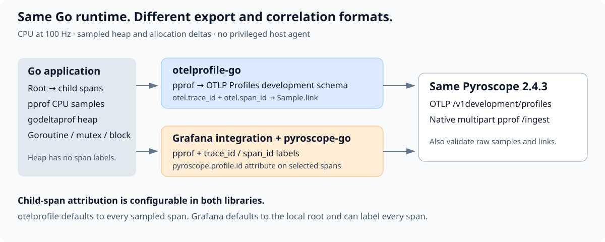
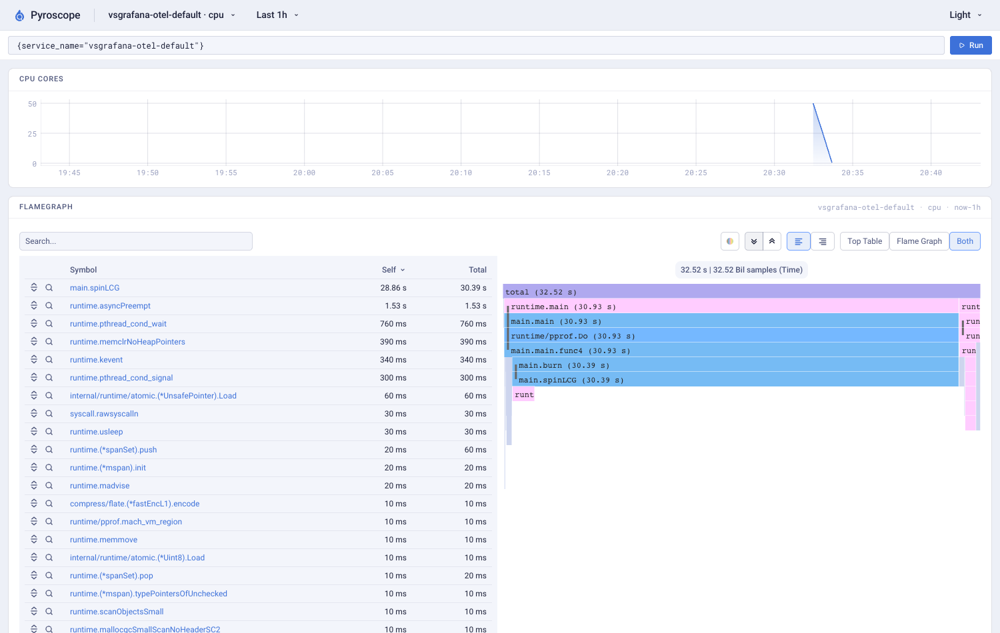
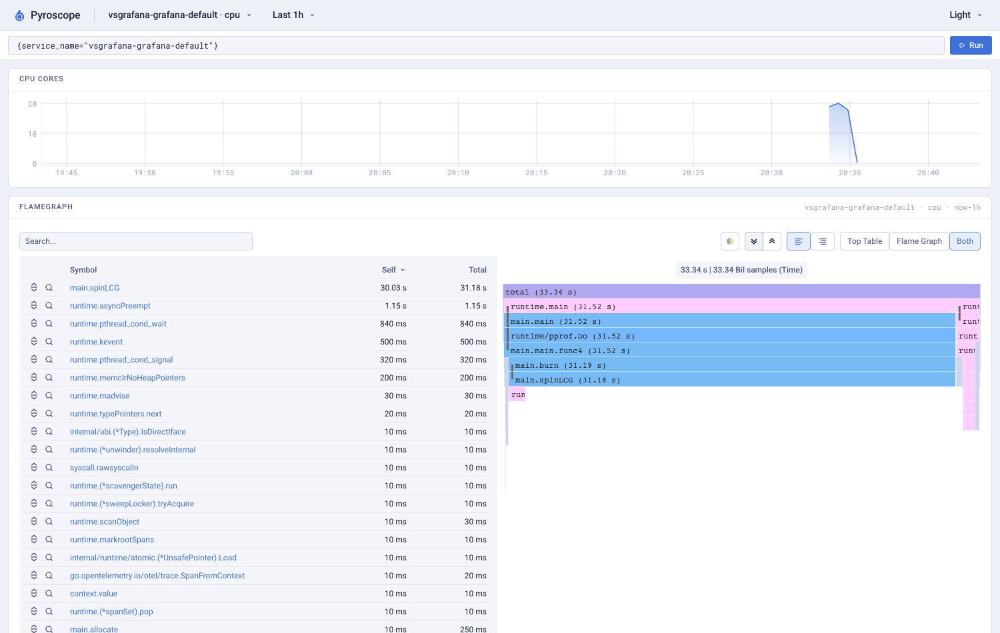
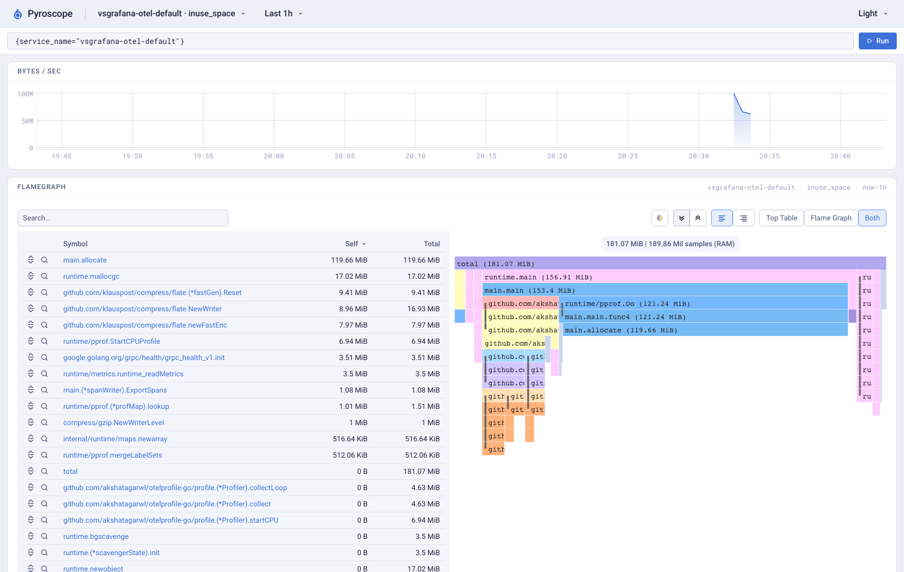
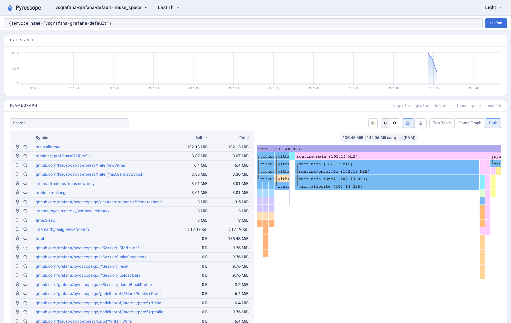

# otelprofile-go and Grafana's Go profiling integration

Choose by export format and backend, not by presumed sampling superiority. Both use Go runtime profiles and Grafana's godeltaprof. Both collected the planted CPU and heap stacks in this comparison.

Grafana's [`otel-profiling-go`](https://github.com/grafana/otel-profiling-go/blob/v0.7.0/README.md) is a tracing integration, not a standalone profiler. It adds pprof labels and a span attribute. We paired it with [`pyroscope-go`](https://github.com/grafana/pyroscope-go/tree/v1.4.0), as its quickstart does. That complete stack supports heap and allocations, not just CPU.

## What differs

| | otelprofile-go v0.3.0 | Grafana integration v0.7.0 + pyroscope-go v1.4.0 |
|---|---|---|
| Collection | CPU and heap by default. Optional goroutine, mutex, and block. | Same default families and optional goroutine, mutex, and block. Also has optional experimental goroutine-leak collection, not tested here. |
| Export tested here | OTLP/HTTP protobuf at `/v1development/profiles`. Development schema, not a stable signal. | Multipart pprof at `/ingest`. The tracing integration itself does not choose an exporter and also works with a pprof scrape setup. |
| CPU correlation | `otel.trace_id` + `otel.span_id` labels become native OTLP `Sample.link` entries. | `trace_id` + `span_id` labels. Selected spans also receive `pyroscope.profile.id` for Grafana's trace-to-profile join. |
| Default span scope | Every sampled span. Root-only is configurable. | Local root. Every-span is configurable with `WithSpanIDLabelScope(ScopeAllSpans)`. This is a default difference, not an exclusive child-span capability. |
| Span name | No automatic span-name label. | Root span name by default. Scope is configurable independently of the ID. |
| Heap attribution | Allocation stack, not the allocating span. | Same. Go heap profiles do not carry these CPU pprof labels. |
| CPU sampling | Go runtime, 100 Hz. Default CPU window 30s and upload interval 15s. | Go runtime, 100 Hz. Default upload/CPU window 15s. |
| Runtime coupling | Go 1.26+ module. Uses godeltaprof's runtime internals by default. Optional `RuntimeDeltas` uses public pprof APIs. | Both modules require Go 1.25+. pyroscope-go also uses godeltaprof's runtime internals. |
| Installation | Import, start collection, wrap the tracing provider for correlation. No privileged host agent. | Import, start pyroscope-go, wrap the tracing provider. No privileged host agent. |
| Backend tradeoff | Use OTLP-capable receivers, including Collector and Sigiro. Check schema revision compatibility. | Direct Pyroscope integration, authentication options, and the existing Grafana trace-to-profile attribute convention. |
| Pyroscope type names observed | Mutex and block land together under `contentions`. | `mutex` and `block` stay distinct. |

Source references: [our configuration](../otelprofile.go), [our tracing wrapper](../profiletrace/profiletrace.go), [Grafana wrapper](https://github.com/grafana/otel-profiling-go/blob/6577d5a059a4f0aed344dc6900c5a14cd3a9955c/otelpyroscope.go), [profiler configuration](https://github.com/grafana/pyroscope-go/blob/d893cd32b650e2e1fff27a09e570b49155037788/api.go), [collection/session logic](https://github.com/grafana/pyroscope-go/blob/d893cd32b650e2e1fff27a09e570b49155037788/session.go), [supported types and defaults](https://github.com/grafana/pyroscope-go/blob/d893cd32b650e2e1fff27a09e570b49155037788/types.go).

## Same workload, same backend

The fixture ran on a shared 10-core macOS arm64 host with Go 1.27.3 and Pyroscope 2.4.3. No privileges, kernel profiler, or eBPF agent were used. Each quality probe completed 900 requests. Each request ran the same 20 million integer-loop iterations and allocated 1 MiB, with a 16-request retention ring. The planted call chain is `main.burn → main.spinLCG`. Each request creates a sampled `request` span with a `compute` child.

These are released library versions, not the unreleased compression branch. The combined fixture's Go module selection uses OTel 1.47.0 and godeltaprof 0.1.12 for both. Grafana's own release declares OTel 1.45.0 and godeltaprof 0.1.11. This controls shared dependencies, but does not reproduce two standalone default dependency graphs. Full resolved versions are in the evidence.

The Grafana integration's collection/correlation code was unchanged between v0.7.0 and checked main `461362b1`. pyroscope-go main `7d9471f5` includes dependency and godeltaprof changes since v1.4.0. We measured the released package, not that unreleased main.

### CPU stacks and correlation

One 90-second quality probe per configuration, with all common profile families enabled. These sample counts are observations, not statistical accuracy rankings.

| Observation | otelprofile defaults | Grafana defaults | Grafana every-span |
|---|---:|---:|---:|
| CPU samples exported | 3,252 | 3,334 | 3,112 |
| Planted leaf samples retaining `burn` caller | 3,039 / 3,039 | 3,118 / 3,118 | 2,922 / 2,922 |
| Samples with resolvable trace+span pairs | 3,095 | 3,159 | 2,961 |
| Of those, attributed to root / child | 265 / 2,830 | 3,159 / 0 | 280 / 2,681 |
| Links with no matching emitted trace+span pair | 0 | 0 | 0 |
| CPU seconds exported / process rusage seconds | 32.52 / 37.25 | 33.34 / 37.53 | 31.12 / 36.47 |

Both retained the planted caller. Profile CPU totals are below rusage over the measured post-init-to-stop interval, whose boundaries differ from the profile windows. All resolvable links matched locally emitted span IDs, but the analyzer does not independently check sample-time/span-time overlap. Do not read this as proof of temporal attribution or universal CPU accuracy.

Our raw pprof and received OTLP totals match for every observed sample type, including the linked samples. Grafana's raw pprof CPU totals also match the stored backend totals.

The same backend's real span-filter queries confirm the scope distinction. Filtering the first 50 child span IDs returned **1.53s** of CPU for otelprofile and **1.43s** for Grafana every-span. Grafana defaults returned **0**, because those samples belong to the root. All three retained the dynamic `route=/work` label in backend queries.

Trace-ID filtering returned HTTP 501 for all three. This Pyroscope configuration requires its v2 query backend for `trace_id_selector`. We did not test Grafana/Tempo trace-page navigation and make no claim that one library's full trace UI integration is better.

### Real CPU and heap screenshots

Each image comes from the same Pyroscope instance, with the service selector checked by the screenshot script. Open an image for its full size.

| | otelprofile | Grafana stack |
|---|---|---|
| CPU |  |  |
| Heap |  |  |

Both heap views contain `main.allocate`. Their displayed totals sum multiple in-use snapshots. They are **not** single live-heap sizes, allocation totals, or a memory-overhead comparison. The final snapshots and collection cadence differ. CPU flamegraph totals were checked against raw samples; the timeline chart is not used for utilization measurements.

Both also exported allocation, goroutine, mutex, and block data. Goroutine labels were observed for both, but only CPU correlation is fully supported by Grafana's README. No heap samples had trace/span labels in any run. No experiment here measures allocation sampling error, long-running leaks, deep recursion, missing inline frames, or cross-goroutine correctness.

## Measured process cost

The cost series alternates five runs of each stack with five unprofiled controls. Each run executes 300 requests, the same integer work and allocation bytes, with CPU+heap only, a 15s upload interval, a 15s CPU window, and every-span correlation. Grafana additionally emits `span_name`. No raw-profile capture runs in these cost probes.

The statistics start **after profiler initialization** and include `Stop()`. This is not total lifecycle cost or a proven steady-state overhead measurement. Native shutdown paths differ. Our profiler collects a final heap snapshot; Grafana flushes its final CPU window. Peak RSS is the process's lifetime high-water mark, so its interval differs from CPU and allocation statistics. Tracing uses the same synchronous local span exporter in every mode.

| Five runs per mode | CPU seconds, median [min, max] | Lifetime peak RSS MiB, median [min, max] |
|---|---:|---:|
| Unprofiled control | 11.927 [11.735, 12.368] | 50.95 [50.19, 52.72] |
| otelprofile | 11.935 [11.885, 12.629] | 57.86 [57.44, 58.19] |
| Grafana stack | 11.815 [11.748, 11.917] | 57.17 [56.98, 58.45] |

The CPU ranges overlap. **The overhead ranking is inconclusive.** The host was running other agents and browser work. Grafana's diagnostic logger is enabled, and its extra span-name labels remain enabled. This is not a clean same-feature steady-state cost study.

All 15 runs completed exactly 300 requests. The fixed 10 requests/s arrival schedule, not saturation, bounds throughput. Raw CPU profiles identify `spinLCG` as the dominant work. The series checks actual completed work and successful ingestion but does not measure maximum throughput or request latency. All **98 profile uploads succeeded**, and stored quality totals match the raw inputs. See [every run](../evidence/vs-grafana/cost-runs.json) and [the summary](../evidence/vs-grafana/summary.json).

## Recommendation

Use otelprofile when OTLP Profiles and native OTel links are the integration requirement, with an explicit plan for development-schema updates. Use Grafana's integration with pyroscope-go when Pyroscope's native path and Grafana's trace attribute convention are the requirement. Grafana can label child spans too, and its profiler already covers heap and allocations.

There is no demonstrated sampling-fidelity advantage here. The libraries share the underlying Go collectors. A dedicated-host, long-running equal-throughput study would be needed to rank overhead. Linux, Windows, additional Go versions, remote TLS/auth failures, and Tempo navigation were not exercised in this comparison.

## Reproduce

See [the commands](../scripts/vs-grafana/README.md), [compact measurements](../evidence/vs-grafana/), and [the decision trail](../scripts/vs-grafana/PLAN.md). The fixture does not change either library or the compression branch.
